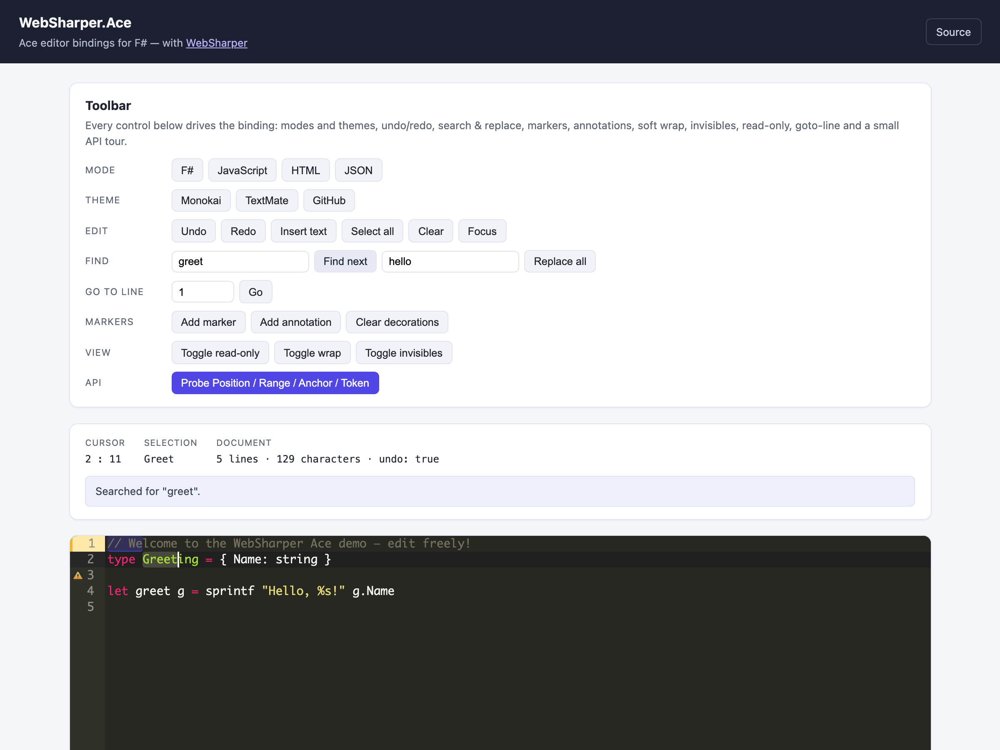

# WebSharper.Ace

[](https://github.com/dotnet-websharper/ace)

WebSharper bindings for the [Ace editor](https://ace.c9.io/) (Ace 1.45.x) —
creating editors, edit sessions, documents, ranges, selections, search, markers,
commands and themes from F# and C# web apps.

The binding consumes the npm package [`ace-builds`](https://www.npmjs.com/package/ace-builds)
as an ES module (`import ... from "ace-builds/src-noconflict/ace"`) and is
bundled by your toolchain (esbuild in the sample) — there is no CDN `<script>`
tag. The editor is created as usual with `ace.edit(...)`; this binding exposes
that as `Ace.Edit(...)`.

This repository contains:

| Project | Purpose |
| --- | --- |
| `WebSharper.Ace` | The binding: WIG definitions for `Ace`, `Editor`, `EditSession`, `Document`, `Range`, `Position`, `Anchor`, `Selection`, `Search`, `UndoManager`, `VirtualRenderer`, `Tokenizer`, `BackgroundTokenizer`, `TokenIterator`, `CommandManager`, `Command`, and the option/config objects. |
| `WebSharper.Ace.Sample` | A WebSharper SPA (esbuild → `dist/`) that wires the whole surface into a working editor with a toolbar. |

## Live demos

**Try it live:** [Open the sample in your browser](https://dotnet-websharper.github.io/ace/)



The sample doubles as the binding's test case: it creates an editor, loads F#
code into it, and drives modes, themes, undo/redo, insert/clear, find & replace,
goto-line, range markers, gutter decorations, annotations, soft wrap,
invisibles, read-only and a Position/Range/Anchor/Token API tour.

- **Sample (this repository):** <https://dotnet-websharper.github.io/ace/>
- **Source repository:** <https://github.com/dotnet-websharper/ace>
- **WebSharper bindings:** <https://websharper.com/bindings>

## Features

- `Ace` (the `ace` object): `edit`, `createEditSession`, `require`,
  `config`, `version`, and overloads for the element/id and option forms.
- `Editor`: value, session, selection, theme, font, read-only, options,
  commands, navigation, search & replace, multi-select helpers, and events.
- `EditSession`: document access, text insertion/removal, markers, gutter
  decorations, breakpoints, annotations, folds, wrapping, screen/document
  coordinate conversion, tabs and the undo manager.
- `Document`, `Anchor`, `Range`, `Position`, `Selection`, `Search`,
  `UndoManager`, `VirtualRenderer`, `Tokenizer`, `BackgroundTokenizer`,
  `TokenIterator`, `CommandManager`, `Command`.
- Option/config shapes: `EditorOptions`, `SearchOptions`, `ConfigOptions`,
  `Annotation`, `Delta`, `Token`.
- All event-emitting classes expose `On`/`Off`/`Once`/`AddEventListener`/
  `RemoveEventListener`/`RemoveAllListeners`/`SetDefaultHandler`/
  `RemoveDefaultHandler`.

## Installation

The binding is not currently published to NuGet. Reference the project from
source:

```bash
git clone https://github.com/dotnet-websharper/ace.git
```

```xml
<ItemGroup>
  <ProjectReference Include="path/to/WebSharper.Ace/WebSharper.Ace.fsproj" />
</ItemGroup>
```

The binding targets `netstandard2.0` and works with WebSharper 10 and 11.

It references the npm package `ace-builds`, so add it to your front-end
dependencies (WebSharper records it as an `NpmDependencies` entry):

```bash
npm install ace-builds@^1.45.2
```

Ace loads modes, themes and background workers on demand. When you bundle Ace
instead of loading it from a CDN, import the ones you use as side effects so
they are registered from the package rather than fetched at runtime:

```js
import "ace-builds/src-noconflict/ace"
import "ace-builds/src-noconflict/theme-monokai"
import "ace-builds/src-noconflict/mode-fsharp"
```

## Usage

```fsharp
namespace WebSharper.Ace.Demo

open WebSharper
open WebSharper.JavaScript
open WebSharper.Ace

[<JavaScript>]
module Demo =

    let createEditor () =
        // `ace.edit` accepts a DOM element or an element id (not a CSS
        // selector), so pass the container's id.
        let options = EditorOptions()
        options.Mode <- "ace/mode/fsharp"
        options.Theme <- "ace/theme/monokai"
        options.FontSize <- "14px"
        options.ShowPrintMargin <- false

        let editor = Ace.Edit("editor", options)
        editor.SetValue "let x = 1\n" |> ignore

        // Events flow through the EventEmitter surface.
        editor.On("change", fun _ ->
            Console.Log("Document changed, cursor at row", editor.GetCursorPosition().Row)
        ) |> ignore

        // Ranges are real `ace.Range` values.
        let range = Range(0, 0, 0, 5)
        editor.Session.AddMarker(range, "my-marker", "text") |> ignore

        // Search options are a plain shape.
        let search = SearchOptions()
        search.Wrap <- true
        editor.Find("x", search) |> ignore
        editor.Focus()
```

The sample imports the npm `ace-builds` core plus the modes and themes it uses
in `entry.mjs`, then the WebSharper-generated bundle; esbuild bundles everything
into `dist/Scripts/WebSharper.Ace.Sample.min.js`. No CDN `<script>` is involved.

## Running the sample

The sample is a static SPA. Building it runs `npm install` and esbuild and emits
`dist/` at the repository root:

```bash
dotnet build WebSharper.Ace.Sample/WebSharper.Ace.Sample.fsproj -c Release
python3 -m http.server -d dist 8099
```

Open <http://localhost:8099/>. Ace is fully bundled, so no network access is
needed.

## Notes on the API

- **The string form of `Ace.Edit` is an element id, not a selector.** Ace looks
  the element up with `document.getElementById`, so use `Ace.Edit("editor")`
  (not `"#editor"`), or pass the element itself.
- **The binding is npm-based.** `Ace` and its classes (`Range`, `Editor`,
  `EditSession`, `UndoManager`, `VirtualRenderer`) are ES-imported from
  `ace-builds/src-noconflict/ace`; nothing is fetched from a CDN.
- **Only the classes Ace exposes on its export object are constructible.**
  `Range`, `Editor`, `EditSession`, `UndoManager` and `VirtualRenderer` have
  constructors; `Document`, `Anchor`, `Selection`, `Tokenizer`,
  `BackgroundTokenizer`, `TokenIterator`, `Search` and `CommandManager` are
  obtained from the editor, session or document (for example
  `session.GetSelection()` or `session.Doc`), so they are modelled without
  constructors.
- **Modes, themes and workers must be registered when bundling.** Import the
  `mode-*`/`theme-*` modules you use (see Installation), and either import or
  disable Ace's background workers (`EditorOptions.UseWorker <- false`).
- **Search needles are strings** in the binding (`SearchOptions.Needle`), while
  the editor's `Find` also has a `RegExp` overload.
- **Union parameters are exposed as overloads.** Where Ace accepts `string |
  HTMLElement`, the binding offers two methods, because WIG's `Union<'a,'b>` is
  explicit at the call site.
- **Modes and themes are strings** (`"ace/mode/fsharp"`, `"ace/theme/monokai"`).
  Custom `SyntaxMode` objects are not modelled.
- **Event names are strings**; the callback receives a plain `obj` (cast or read
  it as needed). Ace's typed event maps are documented in `ace.d.ts`.

See [docs/ace-api-discrepancies.md](docs/ace-api-discrepancies.md) for the full
list of differences between this binding and the published Ace types, and what
changed in this modernization.

## Building from source

### Prerequisites

- [.NET SDK 10](https://dotnet.microsoft.com/download) or later (the WS11 line
  needs the .NET 11 runtime for `wsfsc`).
- [Node.js](https://nodejs.org/) (for the sample's esbuild step).

### Build

```bash
dotnet tool restore
dotnet paket restore
dotnet build WebSharper.Ace.sln -c Release
```

The binding targets `netstandard2.0`; the sample is a static bundle.

### Pack

```bash
dotnet paket pack ./nuget
```

## Deployment

Pushing to `master` triggers `.github/workflows/ghpages.yml`, which builds the
sample in Release and publishes `dist/` to the `gh-pages` branch.

## Repository layout

```
WebSharper.Ace/                 # binding (WIG definitions)
  Main.fs
  wsconfig.json
WebSharper.Ace.Sample/          # SPA demo/test case
  Client.fs
  index.html
  css/index.css
  entry.mjs                     # npm ace-builds + modes/themes entry
  esbuild.config.mjs
docs/
  sample.png                    # screenshot of the running sample
  ace-api-discrepancies.md      # old-vs-new API notes
.github/workflows/ghpages.yml   # build + deploy the sample
```

## License

Apache 2.0 — see [LICENSE.md](LICENSE.md).
